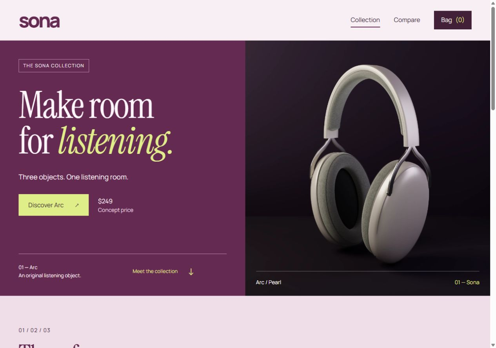
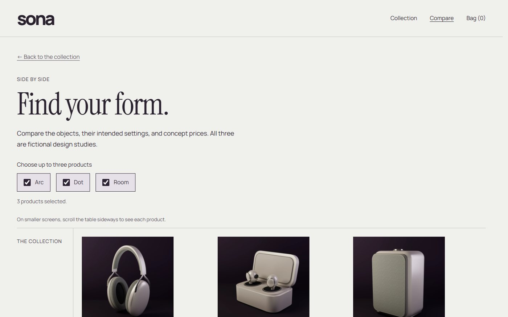
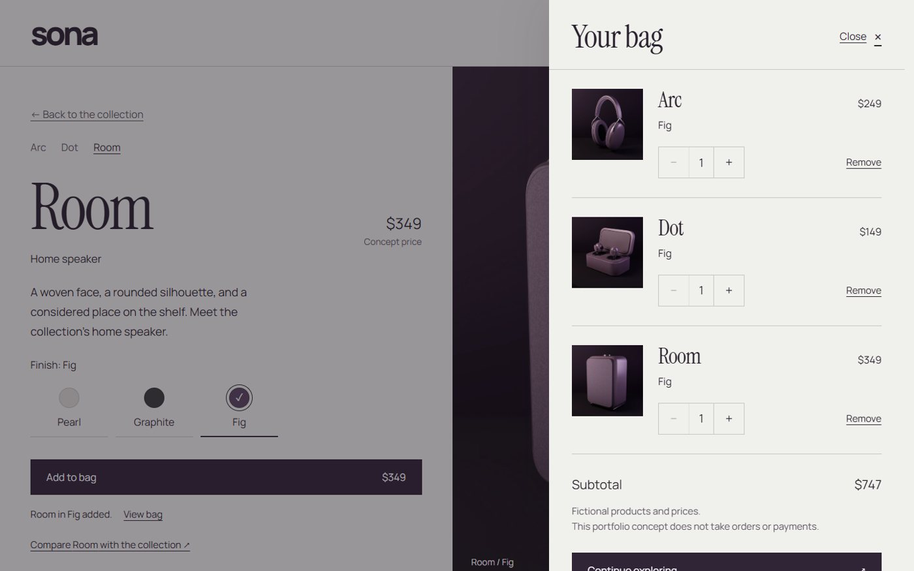
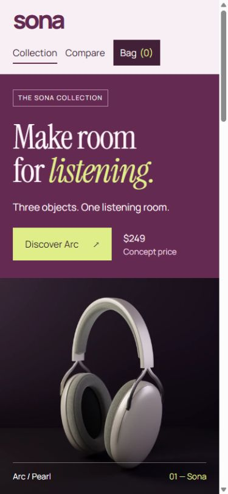

# Sona

A storefront for three audio products that only exist here: Arc headphones, Dot earbuds and the Room speaker. Pick a finish, compare the lineup and build a bag. The products and prices are made up, and there's no checkout.

**[Live site](https://sona-store.vercel.app)**



## What it does

- **Three products, three finishes each.** Switching between Pearl, Graphite and Fig swaps perfectly aligned renders, with a close-up of the materials.
- **Compare up to three products** side by side in a table that stays keyboard-scrollable on small screens.
- **A bag that remembers.** The same product and finish merge into one line, quantities run from 1 to 99, and the bag survives a reload. If storage is blocked, it still works in memory and says so.
- **The URL holds the state.** Finish, comparison and whether the bag is open all live in the URL, so reload, Back and Forward always land where you expect.
- **Accessible by default.** Native modal dialog, managed focus on route changes, live bag announcements and full reduced-motion support.

| Compare | Bag | Phone |
| --- | --- | --- |
|  |  |  |

## How it's built

- **React 19, TypeScript, React Router 7 and Vite.** No animation or state-management libraries.
- **Motion is hand-written** with CSS and the Web Animations API.
- **The catalog is typed** and prices are stored in integer cents. A reducer owns the bag, validates what it loads from storage and never trusts saved data blindly.
- **Product images are rendered from my own Three.js models** and baked to WebP, so shoppers don't download a 3D engine. See [assets/](assets/README.md).

## Run it

```sh
npm ci
npm run dev        # http://127.0.0.1:4173
npm test           # bag and storage unit tests
npm run test:e2e   # Playwright browser suite with axe checks
npm run build
```

Fonts are Instrument Serif and Manrope, self-hosted with their licenses.

Made by [Kareem Alwan](https://kareemalwan.vercel.app).
